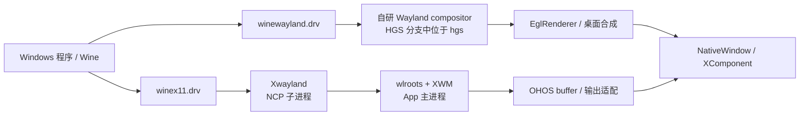
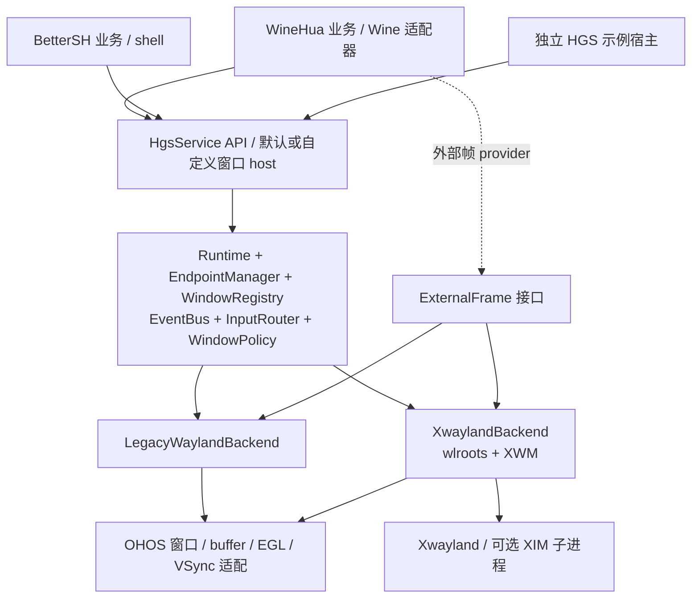

# HGS 双协议图形窗口服务：现状解读与迁移规划

日期：2026-11-06。状态：规划，未实施代码迁移。

执行进度：P0 基线采集与归档已完成，两套主机测试、构建签名和同设备 Wayland/X11 图形及窗口/输入回归已留档。完整 Mono 首启、X11 帧归还同步及部分功能仍有失败；X11 功能测试采用独立无 Mono 配置，不代表产品全绿。P1 公共服务边界、构建及本轮设备验证已完成，Vulkan 稳定性验收仍开放；P2 的真实 X11 后端已通过最终最小宿主真机验证，覆盖异步启停、启动回滚、重连和双端点监听。详见 [P2 实施账本](hgs-p2/README.md)。P3 已接通 Wine 子进程的显示环境、X11 顶层窗口的 OHOS Surface 呈现和子窗口输入，真机验证了 Win32 建窗、GDI 读回、屏幕重绘、窗口销毁和键鼠事件。XIM 已通过 Xlib 和 WineHua 真机中文提交验收。外部 GPU 帧通过了真机 WGL、Vulkan 和 GDI 回退验证。X11 虚拟桌面已通过按逻辑输出上屏、首帧就绪与冷启动 Notepad 的真机回归。P4 默认宿主通过了 Wayland GTK 与 X11 同时呈现、交替键鼠输入、缩放、弹窗与模态、关闭及原会话双路重连。详见 [P3 实施记录](hgs-p3/README.md)。结果见 [P0 基线账本](hgs-p0/README.md) 和 [P1 实施账本](hgs-p1/README.md)。

本文依据 `docs/HANDOVER.md`，并核对以下本地代码，不把历史设计稿中的目标当作已实现能力：

- WineHua 当前分支 `feature/hgs-har-scaffold`，HEAD `3355dab96`。
- 当前 HGS 工作区 `bad402d`，子模块内部 clean；WineHua 外层指针仍有未提交变化。
- 本地 `upstream/master` = `a001e6d0c`。X11 栈在这个版本中，尚未合入当前分支。
- BetterSH 当前接入代码：`feature/bsh_main/src/main/ets/entryability/EntryAbility.ets` 与 `apprunnerability/AppRunnerAbility.ets`。

这次只新增规划文档；没有合并上游、修改 HGS、更新子模块、构建 HAP 或运行真机回归。交接文档中的冲突数量、历史设备结果是已有记录，本次未重新执行合并实验或设备测试。

## 1. 建议结论

把 HGS 提升为**协议无关的图形窗口服务**：统一生命周期、端点、窗口身份、事件、输入路由与宿主窗口接入；内部先保留两个独立后端：

1. `LegacyWaylandBackend`：承接现有 HGS 自研 Wayland compositor。
2. `XwaylandBackend`：承接上游 wlroots + Xwayland + OHOS 输出适配。

宿主使用 `start({ protocols: 'wayland' | 'x11' | 'both', ... })` 启动服务，获取真实可用的客户端连接信息，然后自行启动 Wine、shell 或其他应用。HGS 不根据 Wine 是否启动、是否存在 explorer、是否还有窗口来决定服务存活。

**先统一服务边界，再迁入 X11，最后收敛合成实现。** 不在首次迁移中同时重写 Wayland 协议实现、窗口策略和 GPU 同步。

首个双协议交付目标是：同一 HGS 服务同时接纳两类客户端，混合管理它们的独立宿主窗口。单协议的 DesktopRoot 模式保留。双协议混合到同一个 DesktopRoot 画布另设明确阶段，不能把“两个后端都启动”宣称为“已经统一桌面合成”。

## 2. 加入 X11 后，WineHua 的图形栈如何工作

### 2.1 先区分三件事

- **窗口协议**：窗口创建、几何、标题、焦点、键鼠、关闭等。可以走 Wayland 或 X11。
- **应用绘图与 GPU 执行**：Wine GDI、OpenGL、DXVK/VKD3D、Mesa、VirGL/Venus。
- **宿主合成与呈现**：把窗口内容合成/绘制到 OHOS NativeWindow，由 XComponent/系统窗口承载。

选择 X11 改变的是第一层，以及第三层的合成器接入；不会把第二层已有的 vtest/VirGL/Venus 链全部替换成传统 Linux X11 的 GLX/DRI3 图形栈。

### 2.2 两条路线



上图表达合并后的逻辑位置；在 `a001e6d0c` 原始上游树中，自研 Wayland compositor 仍位于 entry，尚未使用 HGS。

**“X11 路线”内部仍然包含 Wayland。** Xwayland 对客户端提供 X11 服务，对 wlroots 则是 Wayland 客户端，使用私有传递的 `WAYLAND_SOCKET` fd。Xwayland 是 X server，wlroots 里的 XWM 负责 X11 窗口管理协议；二者不能混称。

当前 `display_compositor.cpp` 建立自己的 `wl_display`、headless backend、renderer、seat、Xwayland server 和 XWM。此初始化路径没有建立面向普通 Wayland 应用的公共 socket，也没有创建 xdg-shell。因此，仅仅打开 X11 路线，不能让普通 GTK Wayland 客户端连接进来。

### 2.3 启动顺序

当前上游的产品入口是 `DisplayRouteService.applyRoute()`：

1. 根据 want 参数、持久化设置、默认值决定路线；上游默认 `x11`。
2. 切走 X11 时请求停止旧显示链；把选择写入 Wine 环境的进程级镜像。
3. 选择 X11 时立即调用 `startDisplayRouteChain(0n, ...)`。此时可以没有画布。
4. C++ 启动显示循环，创建 wlroots 对象、虚拟键盘/seat、Xwayland server。
5. wlroots 的 OHOS 补丁调用 `wlr_ohos_spawn_xwayland()`，用 NCP 启动 `libxwayland_child.so:Main`。
6. 通过命名 fd 传递 X 监听端、Wayland 通道、WM 通道、displayfd；shim 调用 `libxwayland_ohos.so` 的入口。
7. 通过事件循环中的延后任务建立逻辑 output 和 `wl_output`，即使 NativeWindow 尚未到达也先提供有效屏幕尺寸；画布晚到再挂接。
8. 收到 Xwayland ready 后拉起 XIM 子进程；测试 X client 只有 smoke 打开时才启动。输出任务与 ready 回调是异步分支，二者没有固定的完成先后。

这里不能等 Wine 窗口出现才启动图形服务：Wine/explorer 已经需要连接 X server，而 Xwayland 又需要有效 output 才能向客户端报告屏幕。现有代码曾遇到没有 output、X 屏幕为 0×0、窗口无法 map 的问题。

HGS 新接口应把“监听就绪”“X server 握手就绪”“逻辑输出就绪”“有物理画布可呈现”“应用首帧”分开。`start()` 成功不应依赖 explorer 首次 map 或某个 ready 文件。

### 2.4 普通窗口内容路径

当前 Xwayland 构建关闭 `glamor` 和 `glx`。OHOS 补丁还关闭客户端侧 MIT-SHM 扩展，避免已知 SysV IPC 限制。

普通 X11 位图绘制经 X 协议进入 Xwayland；Xwayland 再把窗口内容以 Wayland buffer 交给 wlroots。**X11 的 MIT-SHM 与 Xwayland→wlroots 的 `wl_shm` 是不同机制**，不能因前者关闭就判断后者也关闭。

wlroots 当前优先使用 OHOS EGL 导入支持的 GLES2 renderer，创建失败才退回 pixman；交接文档中的 pixman 概括是起步路线，不能据此把当前实现描述为始终 CPU 合成。

### 2.5 GPU 内容路径

```text
D3D11 / D3D12
  → DXVK / VKD3D → Wine Vulkan 私有呈现接口
  → guest Mesa Venus → vtest → host virglrenderer Venus
  → Venus presenter → OHOS BufferQueue
  → display_guest_frames → 对应 X 窗口的合成节点/呈现器

OpenGL
  → winex11 的 opengl_winehua 私有实现（EGL / pbuffer）
  → guest Mesa virpipe → vtest → host VirGL
  → VirGL presenter → OHOS BufferQueue
  → display_guest_frames → 对应 X 窗口的合成节点/呈现器
```

这两条链上的游戏主帧不必经 XPutImage 搬运。X11 提供窗口身份和几何；私有图形通道提供帧，两者在宿主重新关联。

`display_guest_frames.cpp` 的关键工作是：

- 从 `GraphicsBroker` 获取待绑定 surface 列表；当前键含 `(pid << 32) | surfaceId`。
- X11 路线中 `surfaceId` 表示 X window ID；验证该 X 窗口已存在且关联到 surface。
- 创建 OHOS consumer surface，把对应 producer window 交给 GPU presenter。
- 每帧 acquire buffer，包装为 `wlr_buffer`，挂到窗口；释放引用时归还队列槽位。
- 用记录 generation 识别“相同 XID 被新窗口复用”，防止旧帧挂到新窗口。
- 按帧来源处理方向：当前 X11 消费路径 GL 帧要翻转，Vulkan 帧不翻。

虚拟桌面中的 GPU 窗口还可能是 X 子窗口，不能仅按顶层窗口查询。现有 wlroots child-geometry 补丁和 child-face 管理正是在补这个呈现锚点。

零 CPU 拷贝路径不等于没有 GPU blit，也不等于所有平台都保证走同一路径。当前代码还有 EGL swap、直接 buffer 呈现和 CPU 回退。buffer 归还与 GPU 完成的同步约束必须一起迁移；历史问题文档记录过启动期同步计数异常，不能无测试地把它描述成已经完全解决。

### 2.6 两种窗口承载

| 形态 | 当前 X11 实现 | 迁移后建议名称 |
|---|---|---|
| 单画布桌面 | wlroots scene 把多个 X surface/guest frame 合成到 root 输出，再呈现到一个 NativeWindow | `DesktopRoot` |
| 多个鸿蒙窗口 | `x11_toplevel` 为 X 窗口建立映射，各自绑定 NativeWindow，逐窗 render pass 呈现 | `PerWindow`，兼容旧 `PerToplevel` |

Xwayland 在两种形态下仍是 rootless；Wine 的虚拟桌面和宿主的单画布组合不等于把 Xwayland 改成 rootful。

`x11_toplevel_bridge.cpp` 把 XWM 的创建、标题、状态、popup、modal 事件转成既有 toplevel 事件。上层继续使用 WineHua 的窗口管理器。反向的宿主 resize/move 会回写 X 窗口几何，并抑制回声，避免双方互相触发 resize。

当前多窗实现并不是简单的“每个 X 窗口都有一个 wlr_output”：它保留逻辑 headless output，同时使用逐窗 NativeWindow 呈现。规划不能照抄早期设计稿的 output 数量假设。

### 2.7 输入、焦点和输入法

X11 常规输入：ArkTS/宿主事件 → NAPI → 投递队列/唤醒 fd → compositor 线程 → `wlr_seat` → Xwayland → X11 客户端/Wine。

- 单画布模式根据桌面坐标命中 X surface，处理 letterbox 反变换。
- 多窗模式先按宿主窗口定位 X 窗口，再注入局部坐标；还要同步 X restack 和焦点。
- Wayland 路线走 HGS 的 InputManager/Seat；BetterSH 已用 NativeXComponent 原生输入回调。
- Wayland IME 走 text-input-v3；X11 IME 走独立 NCP XIM server，通过 socketpair 接收 commit 并回传激活/失活。

当前 XIM 承载不是早期设计中的“Xwayland 自动桥 text-input-v3”。代码与项目实测记录显示主进程直接 XOpenDisplay 有可达性问题，因此采用 NCP 子进程。

## 3. 迁移前必须消除的耦合

| 现状证据 | 对通用 HGS / both 的影响 | 处理方向 |
|---|---|---|
| `x11_toplevel_bridge.cpp` 调 `WaylandServer::PostToplevelEvent` 和 `AllocateToplevelId` | X11 借用另一后端的事件/身份管理 | 迁入公共 `WindowRegistry` / `EventBus` |
| `HgsInstance::Impl::BuildWindowSpec` 从 Wayland `SurfaceData` 查询信息 | 把 X11 ID 塞进总线仍无法获得正确窗口快照 | 两后端直接上报完整的类型化窗口事件 |
| `plugin_manager`、NAPI 用全局 `x11_toplevel_active()` 分流 | X11 多窗开启会把 Wayland 窗口误投到 X11 | 按 `WindowId → backend` 路由 |
| `display_guest_frames` 直接 include `graphics_broker.h` | HGS 编译依赖 WineHua | 改为注入的外部帧 provider |
| surface 发现以 `surfaceId >= 0x200000` 区分 X11 | 同时运行时不能靠 ID 数值猜协议 | provider 帧元数据明确携带协议、连接、后端和代次 |
| `DISPLAY=:0`、XIM `XOpenDisplay(":0")` | 实际分配 :1 等值时连接错误；多实例冲突 | 从 Xwayland 实际 display name 返回/传递 |
| xkb、xkm、locale、ready/framedump 路径依赖 `wine/`、`.wine/drive_c` | 不安装 Wine 就无法独立启动 | ResourcePaths 配置；Wine 标记文件移到适配器 |
| 启动代码无期限等待 Wine 引擎包 | 无法取消，图形服务被业务初始化阻塞 | 独立资源准备、显式错误、可取消启动 |
| `TrySpawnXimServer` 的函数内 static `spawned` | 失败也置位，不能按会话重试/复位 | 会话拥有 XIM 进程句柄、通道、ready 状态 |
| `Stop()` 发管道消息，主循环线程 detach | stop 返回不代表资源已释放 | 异步 stop 完成契约，等待线程退出和引用释放 |
| `ResolveHostSymbol()` 回退查找 `libentry.so` | 所谓通用库仍认识具体宿主库名 | 显式安装 provider；旧 seam 放兼容层 |
| `FeatureConfig` 大多只解析，协议仍恒注册 | `winehuaToplevel:false` 不是有效隔离 | 按配置真实注册，报告实际能力 |
| HGS data-device 为 stub | GTK 能建 seat 不等于完整剪贴板/DnD | 报告能力层级；完整数据交换单列验收 |
| X11 窗口表上限 64，override-redirect 统一按 popup 分类 | 通用客户端可能静默丢窗，或把无 owner 的特殊窗口误分类 | 动态/显式限额；标准角色与宿主启发式分开 |
| HGS 默认依赖 Wayland 1.22，上游已升到 1.26 | 两套头/so 混装有运行风险 | 固定兼容版本和唯一宿主依赖闭包 |

额外发现：HGS `setProcessEnvironment=false` 时，`WaylandServer::Start()` 仍把 basename 传给 `wl_display_add_socket()`；当前 libwayland 对相对名字读取进程 `XDG_RUNTIME_DIR`。所以这个选项目前只保证不写环境，不保证监听地址与配置一致。应传绝对 socket 路径，或自行 bind 并用 `wl_display_add_socket_fd()`；同时明确 lock、清理和 fd 所有权。

另一个应纠正的文档细节：上游 `JsonCreatedAt()` 是带坐标的 Created payload 构造函数，不是新的 CreatedAt 事件枚举；HGS 现有枚举已经含 Restored、Modal。合并时对齐实际数值、payload 和消费者，不机械添加重复事件。

## 4. 服务目标和非目标

HGS 应负责：监听/连接、两类窗口协议、窗口注册表、通用焦点/模态/popup 语义、输入分发、surface 生命周期、OHOS 呈现、服务所需 Xwayland/XIM 子进程、资源和可诊断状态。

宿主保留：

- WineHua：Wine/box64/wineserver、Wine 前缀、进程与音频 broker、DXVK/VKD3D/Mesa 配置、GraphicsBroker、Wine 专用图形协议和桌面业务策略。
- BetterSH：shell/终端、IEC/procmgr、环境合并、包管理、设置与业务页面。
- 宿主共性：提供 UIAbilityContext、选择显示形态、启动应用客户端、管理应用自身生命周期。

HGS 可带默认 ArkTS 窗口 host，也允许宿主替换策略/host。每个窗口只有一个实际窗口创建者，不能同时让默认 host 与 WineWindowManager 重复创建。

“解耦”首先指**同一源码/HAR 能被任意宿主使用**，并能在无 WineHua/BetterSH 的样例中启动。HGS 仍需运行在有 OHOS 窗口能力的宿主中；HAR 本身不是独立常驻应用。

如果最终需要一份独立 HGS 应用跨 HAP 服务多个沙箱，还需单独的 IPC、连接授权、fd/NativeWindow 传递和系统生命周期设计。现有同应用沙箱 socket 不能自动跨应用可达。本轮先保留这种扩展边界，不以改目录宣称已获得系统服务能力。

通用 X11 支持首先覆盖现有构建的窗口/位图/输入能力；不承诺任意第三方 Linux GLX、DRI3 或 Vulkan WSI 程序立即拥有 GPU 加速。Wine 私有呈现已跑通不等于通用 X11 GPU 栈已经补齐。

## 5. 目标结构



这里统一的是控制和身份，不强行把现有 EGL renderer 与 wlroots renderer 合并为同一个类。协议对象和线程仍由各后端拥有；公共层不能查询另一后端的 `wl_resource*`、`wlr_surface*` 或 XWM 指针。

### 5.1 公共身份和事件

- `WindowId` 由 HGS 分配，toplevel/popup 都进入同一受管身份空间；XID、wl object ID 仅为后端内部标识。
- registry 记录 `runtimeEpoch/backendId/protocol/clientId/nativeId/objectGeneration`，surface 绑定另有 `surfaceGeneration`。
- Wayland 原生对象 ID 还必须带连接身份，不能仅用 PID；同进程可有多个 Wayland 连接。
- ArkTS 公共 ID 使用不透明字符串或 bigint，不能把任意 64 位整数塞进 number 丢失精度；v1 数字 ID 由兼容表映射。
- 后端产出不可变、拥有自身数据的事件快照，包含 title、appId、parent、role、geometry、limits、state、origin、serial。异步队列不能引用生命周期不明的 `string_view`。
- Request 和 Applied/Changed 区分；host 回执带 serial/origin，避免几何与焦点反馈循环。
- 关闭请求与窗口销毁区分：客户端有权先弹保存对话框；收到 close 不等于立刻终止宿主 Ability。

标准 parent/transient/modal/override-redirect 信息由后端上报。Wine 特有的“某类 owned window 当 modal”“某窗是 explorer 桌面”等判断放在 Wine policy；通用 host 不能把所有 override-redirect 窗都假定为有父窗口的菜单。

### 5.2 输入和共享服务

统一输入入口：`sendPointer(windowId, ...)`、`sendKey(windowId, ...)`、`sendScroll(windowId, ...)`。InputRouter 根据注册表分派。NativeXComponent 和 ArkTS 只是输入来源，不能再用一个全局 route 判定目标。

统一焦点仲裁，切换协议时通知旧后端失焦，并按按下/抬起配对处理捕获，避免一个键同时发送给两个 seat。坐标系统显式区分物理像素、内容逻辑坐标、桌面坐标、CSD 偏移与 letterbox。

IME 用公共 text-input session 表示焦点、光标矩形、commit/preedit 支持；后端分别接 text-input-v3 或 XIM。现有 XIM 的实际能力先如实报告，不能把 text-input-v3 所有能力视为 XIM 已实现。

剪贴板桥接应有来源和序号，防止 OHOS→Wayland→X11→OHOS 循环；不同后端共享数据需要单独实现。data-device stub 只解决 seat 注册门槛。

### 5.3 外部帧扩展

把 `display_guest_frames` 拆为通用帧导入/绑定管理与 WineHua provider 两部分：

- HGS 识别明确的 ExternalSurfaceRef，管理队列、尺寸、方向、帧节奏和 buffer 生命周期。
- WineHua 适配器负责把既有 `(pid,surfaceId)` 和 route/session 信息映射成明确的后端目标，并调用 GraphicsBroker。
- provider 必须给出 frame/source 类型；不能依靠全局 D3D 档位决定某张帧是 VirGL 还是 Venus。
- 旧私有 present tag 和 guest/Mesa/virglrenderer wire 协议先保持兼容。若元数据不能在宿主可靠补足，再做有版本的协议扩展，不能单边修改。
- core/public headers 不暴露 OHNativeWindow 或 EGL 类型；OHOS producer window 的平台扩展契约单独放在平台头中，用 opaque token 或平台专属接口传递。
- 未安装 provider 时仍应能运行普通 Wayland/X11 客户端；不查找 Wine 的 marker、目录或进程。

保留 acquire/release fence、generation、ready 撤销顺序、队列槽位归还的契约。第一轮迁移不顺手移除 glFinish 或重写 fence 策略，优化另立变更和设备验证。

## 6. start API 设计

以下是**拟议 API**，当前 HGS 不支持这些签名。保持 HAR 根入口，新增 `HgsService`，默认窗口 host 成为它的订阅者。

```ts
const service = HgsService.create(context, {
  windowHost: defaultWindowHost,
});

const session = await service.start({
  protocols: 'both',                 // 'x11' | 'wayland' | 'both'
  composition: 'per-window',         // 单协议还可用 'desktop-root'
  inputBackend: 'native',
  runtimeDir: `${context.filesDir}/hgs/runtime`,
  resources: preparedResourcePaths,
  wayland: { socketName: 'wayland-hgs-0' },
  x11: { display: 'auto', ime: 'xim' },
  output: configuredLogicalOutput,
  startup: { timeoutMs: 15000, failurePolicy: 'atomic' },
  setProcessEnvironment: false,
});

const x11Env = session.clientEnvironment({ protocol: 'x11' });
const waylandEnv = session.clientEnvironment({ protocol: 'wayland' });
// 宿主将返回的 set/unset/fd 信息应用到自己启动的子进程。
// HGS 不负责启动 wine 或 shell。

await service.stop();
```

`protocols` 是外部暴露能力，不能命名成互斥的 renderer/backend。`x11` 模式内部仍需 wlroots 的私有 Wayland 通道，但不向普通客户端发布 Wayland endpoint。

| 模式 | 外部端点 | 内部实现 | 不应额外发生的行为 |
|---|---|---|---|
| wayland | Wayland socket | LegacyWaylandBackend | 不启动 Xwayland/XIM |
| x11 | X11 display/socket，必要时授权信息 | XwaylandBackend + 私有 Wayland fd | 不启动旧 HGS Wayland server |
| both | 两种实际可用的端点 | 两后端并存，共用服务控制层 | 不让全局路线覆盖另一端 |

返回值至少包含实际 display/socket、backend 状态、实际 capabilities、runtime epoch；配置中的 `auto` 不能原样当成可用 endpoint 返回。`DISPLAY` 取实际值，不能写死 :0。

环境接口建议返回 `{ set, unset, inheritedFds }`：

- Wayland：XDG_RUNTIME_DIR、WAYLAND_DISPLAY；需要强制路线时去掉继承的 DISPLAY。
- X11：DISPLAY、实际使用的 XAUTHORITY/XMODIFIERS；去掉继承的 WAYLAND_DISPLAY/WAYLAND_SOCKET。
- 双协议自动选择：可同时提供两种变量，由 toolkit 自行选择；一个普通客户端通常只连接其中一种。
- Wine 的驱动选择、WINEHUA_*、注册表/启动参数留在 WineHua。NCP 客户端不能假设继承主进程环境，必须显式下发。

`start()` 在请求的必需 endpoint 和逻辑输出全部 ready 后 resolve。XIM 如果请求为必需能力，也应等待其注册完成；可选能力失败则返回明确降级状态。无画布时可以 ready，允许以后 attach。

同配置重复 start 幂等；不同配置在运行中返回配置冲突，调用方 stop 完成后再 start。第一版不承诺原地切换协议。both 的启动失败默认整体回滚；运行后某个后端失效则报告该后端断连，保住可独立运行的另一端。Xwayland 重启会使原 X 客户端连接失效，不能承诺旧窗口透明恢复。

旧 `startServer(socketPath | HgsStartConfig)` 继续作为 Wayland 兼容入口；保留旧数值、默认值和“不覆盖宿主已设置输出”的语义。新接口使用明确配置；新旧若共用同一实例，应检测冲突，不能各自悄悄创建第二个服务。

## 7. 生命周期、线程与资源所有权

服务状态：`Stopped → Starting → Ready → Stopping → Stopped`；失败保存结构化错误和失败阶段。每次 start 分配新的 epoch，过期回调不能操作新会话。

- 服务拥有后端实例、端点和窗口 registry；后端拥有自己的协议 event loop 和原生协议对象。
- Native/UI/VSync/子进程线程经命令队列投递；wlroots 对象只由所属线程访问。
- NAPI 回调使用线程安全队列；宿主 Ability 创建失败、迟到 attach、destroy 后才到的 surface 回调，都通过 epoch/generation 检查。
- surface detach 只释放承载面；最后一个客户端关闭后服务继续监听；关闭 Wine 会话只关闭属于它的窗口/连接，不停止通用服务。
- `stop()` 完成意味着：不再接新客户端，停止接受新帧/新输入，清理 IME/捕获，撤销外部帧 ready，排空并释放帧引用，关闭客户端和受管子进程，摘监听器，回收输出/renderer/display，等待线程结束，清理自身端点。
- 销毁次序沿用已验证约束：guest frame 先摘，再销毁其消费者；Xwayland surface 清理完成后才拆 output listener；EGL 最后一个使用者退出后再销毁上下文。
- NCP launcher 记录自己启动的子进程和 fd 所有权，按平台能力实现观察/关闭；不能沿用普通 Unix `waitpid` 假设，也不能全局杀 Wine/shell。
- socket 冲突明确失败或自动分配其他名字，不先 unlink 另一个仍在运行的服务的 socket。

每个进程第一版只保证一个 HGS runtime，同一 runtime 支持 both。把静态全局状态移入实例是生命周期隔离的必要工作；同时运行多个 HGS runtime 需要独立验收，不因存在 `create()` 就默认承诺。

## 8. 建议目录结构

保留 HAR 必需的根布局，将协议、平台、业务扩展从平铺目录分开：

```text
hgs/
├── Index.ets                         # 稳定 ArkTS 导出门面
├── README.md
├── oh-package.json5
├── build-profile.json5
├── docs/
│   ├── architecture/                # 边界、所有权、协议模式
│   ├── api/                         # ArkTS / native 契约与版本
│   └── integration/                 # generic / WineHua / BetterSH
├── src/main/
│   ├── cpp/
│   │   ├── CMakeLists.txt
│   │   ├── include/hgs/             # 公共平台无关头
│   │   ├── core/                    # registry/events/policy/geometry
│   │   ├── runtime/                 # start/stop/endpoints/资源/后端装配
│   │   ├── backends/
│   │   │   ├── backend.h            # 内部协议后端接口
│   │   │   ├── wayland/             # 现有 compositor/seat/协议实现
│   │   │   └── xwayland/
│   │   │       ├── runtime/         # wlroots display / Xwayland supervisor
│   │   │       ├── xwm/             # X 窗口映射、几何、popup
│   │   │       ├── input/           # wlr seat / 输入 / XIM 协议侧
│   │   │       ├── render/          # scene / per-window / 帧锚定
│   │   │       └── ohos/            # wlr_buffer / allocator 平台接合
│   │   ├── presentation/            # frame provider / output 公共契约
│   │   ├── platform/ohos/
│   │   │   ├── surface/            # NativeWindow / NativeImage / 代次
│   │   │   ├── graphics/           # EGL / buffer / VSync 基础封装
│   │   │   ├── input/              # NativeXComponent / keymap / IME host
│   │   │   └── process/            # NCP launcher 和 child entry shim
│   │   ├── extensions/winehua/      # 可选旧私有协议/兼容适配
│   │   ├── bindings/napi/           # 解析、回调、runtime/window/input
│   │   ├── compat/v1/               # 旧导出、旧 ID / seam 转发
│   │   ├── logging/
│   │   └── types/libhgs/Index.d.ts  # 保持现有打包约定
│   ├── ets/
│   │   ├── api/                     # HgsService / public types
│   │   ├── components/              # HgsSurface / HgsWindowPage
│   │   ├── host/                    # 默认窗口 host / Ability
│   │   └── input/                   # 通用输入转换
│   └── resources/rawfile/hgs/       # 自有资源命名空间
├── protocols/                       # XML；生成物放 build/generated
├── deps/
│   ├── lock.json                    # 版本、commit、hash、来源、patch 顺序
│   └── patches/{wlroots,xserver,xtrans}/
├── scripts/{deps,resources,smoke}/
├── tests/{unit,integration}/
├── examples/minimal-host/           # 无 Wine/BetterSH 的最小宿主
├── thirdparty/                      # 可再生源码缓存
├── build/                           # 中间产物，gitignored
└── libs/<arch>/                     # HAR 打包产物，gitignored
```

不要把所有 `ohos_*` 文件机械移到公共 platform：如 `ohos_buffer` 直接实现 `wlr_buffer`，应先留在 xwayland 的 OHOS 接合层，抽出的纯 OHOS 基础部分才可共享。这样 platform 不会反向依赖 wlroots。

目录迁移分批完成，先保留旧路径 forwarding headers 和 `Index.ets` 导出。不能在首次搬目录时顺便改变外部符号、private protocol wire name、NAPI 参数语义。

### 文件归属对照

| 当前文件/职责 | 目标归属 |
|---|---|
| `display/display_compositor.cpp` | xwayland runtime + 通用服务生命周期；删除 Wine marker/资源等待 |
| `display/x11_toplevel.c`、bridge | xwayland xwm；事件出口改公共 EventBus |
| `display/ohos_output.c` | xwayland render；拆 scene、output、frame clock；通用底座逐步下沉 |
| `display/display_input.c` | xwayland input；上游入口统一 InputRouter |
| `display/ohos_buffer*`、`ohos_egl_import*` | 后端 OHOS 接合 + 可复用平台图形封装 |
| `display/display_guest_frames.cpp` | HGS 外部帧接收/绑定 + WineHua provider |
| `display/ncp/xwayland_child.cpp` | HGS OHOS process shim |
| `display/xim_bridge.c`、`ncp/xim_server_child.cpp` | XIM 协议模块 + OHOS process shim；参数化 DISPLAY/name/locale |
| `display/ncp/xclient_child.cpp`、诊断探针 | tests/smoke，产品启动不自动运行 |
| `display_route/display_route_napi.cpp` | 通用部分进入 HGS NAPI；Wine route mirror 留 WineHua |
| 当前 `hgs/api/*.h` / manager 实现 | include/hgs + core；HgsInstance 调度进入 runtime |
| `compositor/wayland_server.cpp` 中的 NAPI 函数 | bindings/napi，避免后端直接依赖 NAPI |
| `seam/SessionControl` 的 Wine 启动/手柄环境方法 | WineHua adapter；通用能力与 Wine 协议分别归属 |
| `HgsSurface` 的 Wine 业务手势参数 | 通用输入配置留 HGS；游戏/Wine 编排放 WineHua wrapper |
| `graphics_broker`、VirGL/Venus producer、Wine 启动 | 留 WineHua，通过 provider 接入 |

## 9. 构建与资源

构建能力与运行模式分离：`HGS_BUILD_WAYLAND`、`HGS_BUILD_X11`、`HGS_BUILD_XIM`、`HGS_BUILD_WINEHUA_EXTENSIONS`。编入两后端不意味着每次都启动两后端；未编入的能力在 start 时明确报错。

先按当前上游验证过的组合固定依赖：wlroots 0.20.2、Xwayland 24.1.13、Wayland 1.26.0，以及对应 xkbcommon/pixman/XCB 等精确版本；不要无目的追新。由 HGS 的依赖 manifest 管理服务端 host 库、补丁和资源，WineHua 继续管理自己的 guest 图形库。

- 区分 host arm64 与 guest x86_64 的 pkg-config/sysroot/staging，不能让 host wlroots 链入 guest 库。
- HAP 内 libwayland/libxkbcommon 等同 SONAME 只采用一个兼容提供者，检查 HAR/app 重复打包与头库版本混配。
- HGS 独立 checkout 必须可构建，宿主源码缓存只能通过显式路径传入并校验版本；不默默回退到邻居 WineHua/BetterSH。
- 现有脚本会对第三方工作树 checkout/打补丁；新构建在专用 build source tree 应用补丁，不破坏调用方 checkout。
- HGS 提供自己的 xkb、预编译 xkm 或编译能力、X11 locale 等服务必需资源，并校验生成缓存与数据版本。默认资源放 rawfile/hgs，避免和宿主 tools/* 同路径冲突。
- NCP helper 采用 HGS 自有库名，例如 `libhgs_xwayland_child.so` / `libhgs_xim_child.so`；XIM server name 通过配置传递，旧 `winehua` 名称仅作为兼容选项。命名迁移与调用端一起切换。
- GTK/字体用于样例和按需客户端资源配置，不让全套 GTK 成为图形服务默认依赖。
- 资源准备与 start 分离；缺失时有明确路径与组件错误，不等待 Wine 的压缩包解压。
- 日志统一项目 logger，按 runtime/backend/window 标识；不默认写 `.wine/drive_c`。

X11 的实际监听/认证策略也必须显式化。当前补丁使用 `-ac` 并依赖同应用沙箱假设；作为跨应用服务时不能沿用这个假设。常规模式默认本地连接、不无意开放 TCP；跨沙箱授权与可达性只在独立服务阶段设计验证。

## 10. 实施阶段

| 阶段 | 具体工作 | 退出条件 |
|---|---|---|
| P0 基线和依赖 | 固定三个代码版本；保存本地改动；记录单双路线现有回归；整理上游更改与迁移清单；准备独立集成分支/工作树 | 可复现 HGS Wayland 基线及上游 X11 基线；依赖与已知失败有账本 |
| P1 公共服务边界 | 新 start/result/state/endpoint 契约；独立 WindowRegistry/EventBus/InputRouter；LegacyWaylandBackend 适配；修正 socket 环境依赖；保留 v1 转发 | 仅启 Wayland 时 WineHua/BetterSH 行为不回退；无宿主进程环境依赖 |
| P2 迁入 X11 后端 | 按新目录搬移 display；参数化 DISPLAY/资源/XIM；实例化全局状态；补 NCP 生命周期；移除对 WaylandServer/GraphicsBroker 的直接依赖 | 无 Wine/BetterSH 的 minimal-host 可启动 x11，真实 X client 建窗、输入、关闭后继续监听 |
| P3 接回 WineHua | 显式 external-frame provider、Wine policy/session adapter；接 GPU 帧、desktop-ready 业务事件、桌面分辨率；移植上游剩余 Wayland/输入修复 | Wine X11/Wayland 单独运行的 GDI、OpenGL、Vulkan、窗口、IME 基线保持；entry 无 display 副本 |
| P4 both 和默认 host | 按 WindowId 分发渲染/输入；跨后端焦点；popup/modal/close 回路；服务与客户端生命周期分离；默认 host 承接 X11；基础 clipboard 能力按实现验收 | 同时运行 Wayland GTK 与 X11 测试应用，多窗口交替输入、缩放、关闭不串线；任一路无客户端后可重连 |
| P5 双宿主收口 | WineHua 的路线改为客户端启动偏好；BetterSH 接 endpoint/env；清理旧 WaymonyService/ClientWindow 与旧桥；所有通用测试迁回 HGS；完善资源与示例 | HGS 自身可构建测试，两宿主只依赖公共接口与自己的 adapter；服务三种启动模式都过验收 |
| P6 共享桌面合成 | 如要求两协议窗口出现在同一个 DesktopRoot：统一 FrameSource/scene 节点与 Z 序、命中、popup、同步，或经单独论证迁向统一 wlroots compositor | 双协议确实共用一个画布；focus、输入、剪贴板与 buffer 同步有混合用例证明 |

P0/P1 可先做；完整应用集成仍要处理上游合并。交接文档记录的 28 个 modify/delete 文件要把修改移到 HGS 对应实现，不能恢复 entry 中旧 compositor。上游新增 display 可以直接按归属进入 HGS，但不要混入旧 Wayland 目录。

每个阶段拆成可独立验证的变更：先契约/测试，再适配，再移文件，最后删旧入口。跨仓库发布时先推 HGS，再更新宿主的子模块指针。P4 已发布 HGS 和 WineHua 的集成版本，BetterSH 的子模块更新在 P5 验收。[P4 交接](hgs-p4/HANDOVER.md)

P2→P3 的外部帧接口必须按已有真实方法设计；不能为了先搬文件而暂时让 HGS include WineHua headers。临时 adapter 可留在 WineHua，HGS 仍保持单向依赖。

### 关于最终是否统一到 wlroots

长远只维护一套 wlroots scene/seat/renderer 有吸引力：在同一个 compositor 上同时注册 xdg-shell 和 Xwayland，可以简化混合 DesktopRoot。但现有 X11 backend 尚没有普通 Wayland 客户端接入，现有 HGS 又有私有协议、DesktopRoot、输入和 zero-copy 资产。

因此它应是后续独立项目：补公共 Wayland listener/xdg-shell/相关协议，逐项迁移旧语义与帧源，通过两宿主回归后淘汰 legacy backend。本轮对外服务契约保持不变。若 P6 成为近期必需项，应在 P5 后先做技术验证，再在“共享 FrameSource 合成”和“统一 wlroots”中择一，避免同时长期维护两套新的桌面合成实现。

## 11. 验收与回退

### HGS 自身测试

- 模式配置、真实 endpoint、资源缺失、socket 占用、默认值兼容与 feature gate。
- registry 身份隔离：相同 native ID、同 PID 多连接、XID 复用、popup/toplevel、runtime 重启。
- 窗口事件完整性：created 早于 title/geometry 更新、destroy 早于 Ability attach、host 创建失败回滚、关闭请求不等于销毁。
- 两 backend fake/mock 驱动路由：一个窗口的键鼠、resize、close、外部帧不能落到另一后端。
- start 取消/超时/失败回滚；stop 后重新 start；XIM 启动失败重试；读线程/pipe/NCP 资源清理。
- buffer acquire/release 成对、ready 撤销、generation 拒绝旧帧、provider 不存在时普通客户端可用。

这些测试随真实实现落地，不为了纯目录重排增加重复实现型测试。

### 设备矩阵

| 组合 | 必须验证 |
|---|---|
| wayland + PerWindow | GTK 单窗、多窗、CSD 坐标、Native 输入、缩放、关闭 |
| x11 + PerWindow | 普通 X client、多窗、parent/modal、OR popup、几何回写、XIM |
| both + PerWindow | 两类窗口交替焦点/键鼠/IME，旧窗口销毁和 ID 复用，后台一路继续运行 |
| wayland + DesktopRoot | Wine 现有桌面、letterbox、GPU/CPU 帧、相对输入 |
| x11 + DesktopRoot | Wine explorer/桌面尺寸、X 子窗 GPU 帧、OpenGL/Venus、全屏与恢复 |
| both + DesktopRoot | P6 前明确拒绝；P6 后测试真实混合 Z 序、命中、popup 和同步 |
| 任意模式生命周期 | 无画布启动、画布晚到、重建/旋转、关闭最后窗口后重连、重复启停 |

GPU 验收分别记录 producer FPS、present FPS、CPU/GPU 搬运路径、槽位/帧引用与同步计数；使用同设备同场景基线。历史已知失败单独列出，不把迁移验收中的新失败归入旧问题，也不把历史通过当作本次已经测试。

### P4 默认窗口宿主实测

独立宿主通过 `HgsWindowHostService.startService` 启动 both，使用同一会话的两套端点分别运行 GTK 3.24.43（GdkWaylandDisplay）和 Xlib 探针。两种包装页均以 `useSharedStorage: true` 接收各自实例的窗口身份。X11 窗口首帧上屏，GTK 窗口动画同时可见。证据位于 `/workspace/WineHua-root/WineHua/build/hgs-p4/both-verify/`，见 `gtk7-screen.jpeg` 和 `gtk7-initial.log`。

GTK 收到真实指针点击，X11 客户端记录焦点进出、按键和鼠标点击。OHOS 关闭 X11 窗口触发客户端的 WM_DELETE，GTK 窗口继续存在。X11 override-redirect popup 与 transient modal 都上屏，快照均指向对应的父 WindowId。证据见 `gtk7-final-report.log`、`gtk8-popup-report.log` 和 `gtk8-modal-report.log`。

OHOS 边缘拖拽使 X11 客户端收到从 480×280 到 705×430 的 ConfigureNotify，GTK 窗口也完成拖拽缩放。分别关闭某一协议的最后一个窗口时，另一协议的窗口仍存在。新客户端在原 epoch 重连，获得新的客户端和窗口 ID。GTK 使用客户端标题栏关闭，X11 使用 OHOS 标题栏关闭。

将 GTK 移至 launcher 窗口覆盖区之外后，真实按键按 X11 → GTK → X11 的顺序到达各自客户端，GTK entry 收到 `b`。X11 菜单收到发给自身 XID 的点击，模态窗打开后父窗未收到同次点击或按键，模态窗收到按键与 WM_DELETE。两个协议的最后窗口都关闭后，两个客户端仍在原 epoch 重连，并获得新的连接和窗口 ID。证据见 `interactive-final.log`、`interactive-popup-modal-final.log` 和 `interactive-alternate2.jpeg`。

实测发现 XWM 的 MapNotify 可能先于初始属性读取，将默认状态写回并丢失客户端预设的模态标志。HGS 在 map_request 读取初始模态属性。修复后的三轮测试均在 Created 事件得到正确 parentId 与 modal 标志，含同一 epoch 断连后新客户端创建的模态窗。已映射窗口也通过 EWMH ADD/REMOVE 完成 false → true → false 的模态切换，窗口 ID 保持一致，两次重新绑定 OHOS Surface 后均恢复呈现。证据见 `modal-fix-final.log`、`modal-dynamic-add-events.log` 和 `modal-dynamic-remove-events.log`。

GTK 的 data-device 能力覆盖了 seat 初始化和真实输入，跨协议剪贴板单独验收。HGS 和 WineHua 主机测试已通过。

最强的解耦验收是 minimal-host：不链接 WineHua 的 entry、不含 Wine 引擎包、不引用 BetterSH 路径，只安装 HGS 服务资源，三种模式都能启动并监听。单靠源文件移动不能满足这个标准。

## 12. 关键源码索引

上游文件当前不在分支工作树中，可用 `git show a001e6d0c:<路径>` 阅读；以下均已在本次规划中核对。

| 来源 | 文件 / 核对点 |
|---|---|
| 上游 a001e6d0c | `entry/src/main/ets/service/DisplayRouteService.ets`：默认路线与 applyRoute |
| 上游 a001e6d0c | `entry/src/main/cpp/display/display_compositor.cpp`：启动、ready、spawn、环境、stop |
| 上游 a001e6d0c | `entry/src/main/cpp/display/x11_toplevel.c`、bridge：窗口表、popup ID、事件/ID 借用、多窗 render |
| 上游 a001e6d0c | `entry/src/main/cpp/display/ohos_output.c`：逻辑 output、scene、呈现分支、frame_done、child faces |
| 上游 a001e6d0c | `entry/src/main/cpp/display/display_guest_frames.cpp`：broker 依赖、帧归属、generation、队列 |
| 上游 a001e6d0c | `entry/src/main/cpp/display/display_input.c`、`xim_bridge.c`、`ncp/*`：输入、XIM、子进程 |
| 上游 a001e6d0c | `entry/src/main/cpp/bridge/plugin_manager.cpp`、`napi_init.cpp`：全局 x11_toplevel_active 分支 |
| 上游 a001e6d0c | `entry/src/main/cpp/wine/wine_env.cpp`：DISPLAY=:0、Wine route mirror、XMODIFIERS |
| 上游 a001e6d0c | `scripts/build_wlroots.sh`、`build_xwayland.sh`、`patches/*`：依赖、参数、硬编码路径 |
| 上游 a001e6d0c | `docs/engineering/display-route-known-issues.md`：GL 私有通道、同步、XIM 及历史实测边界 |
| 上游引用的 Wine 025656df | `dlls/winex11.drv/opengl_winehua.c`：EGL pbuffer、X 窗口 ID 发布、私有通道启用条件 |
| HGS bad402d | `src/main/cpp/api/hgs_instance.cpp`：硬连 Wayland singleton、窗口信息查询 |
| HGS bad402d | `src/main/cpp/api/hgs_types.h`、`hgs_events.h`、`hgs_window_types.h`：v1 契约 |
| HGS bad402d | `src/main/cpp/compositor/wayland_server.cpp`：监听、环境、恒注册协议、NAPI 混放 |
| HGS bad402d | `src/main/cpp/seam/zero_copy.h`、`registry.h`、`symbol_resolver.cpp`：原生接缝及宿主名称依赖 |
| HGS bad402d | `src/main/ets/service/HgsWindowHostService.ets`、`components/HgsSurface.ets`：默认 host、surface 与输入 |
| HGS bad402d | `scripts/env.sh`：默认 Wayland 版本、邻接宿主源码探测 |
| 当前 WineHua | `thirdparty/wayland/src/wayland-server.c`：相对 socket name 使用进程 XDG_RUNTIME_DIR |

建议的第一笔实现变更是 P1 的协议无关 runtime/registry/event 契约及旧 Wayland 适配；第二步才是 X11 后端迁入。这样每次搬迁都有已定义的接入点，both 也不会依赖全局 route 的临时分支。
